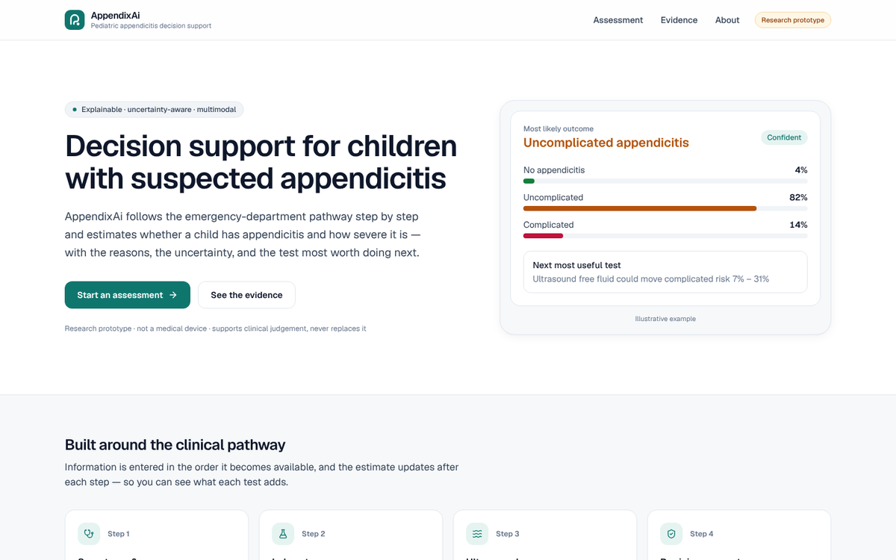
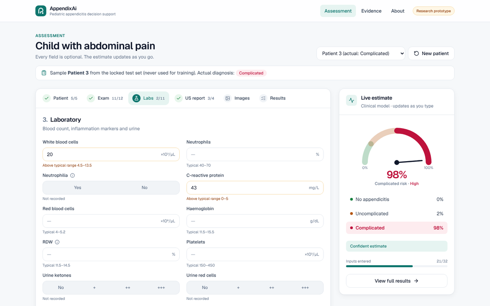
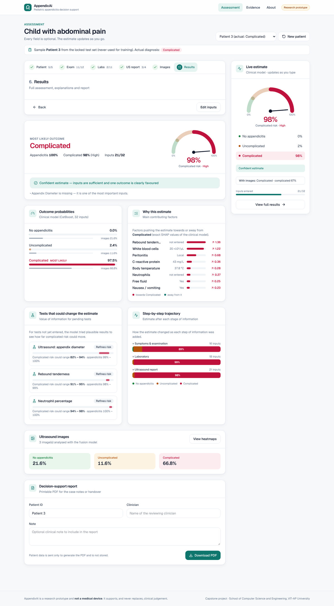
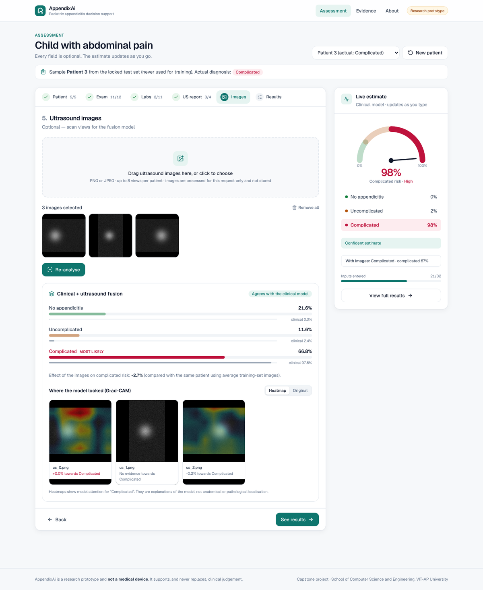

# AppendixAi

**Explainable, uncertainty-aware decision support for pediatric appendicitis severity**, combining routine clinical
data with ultrasound images. Capstone project, School of Computer Science and Engineering (SCOPE), VIT-AP University.

> ⚠️ Research prototype — **not a medical device**. It supports, and never replaces, clinical judgement.



## What the app does

| Feature | Description |
|---|---|
| **Step-by-step assessment** | Patient → symptoms & exam → labs → ultrasound report → ultrasound images, as in the emergency department |
| **Live estimate** | Risk gauge and the three outcome probabilities update as each value is typed |
| **3-class severity** | No appendicitis / uncomplicated / complicated appendicitis |
| **"Unsure → refer"** | Flags low-confidence estimates for senior review, with the reasons |
| **Complicated safety net** | Warns when complicated disease cannot be ruled out even though it is not the top prediction |
| **Why this estimate** | Exact SHAP contributions of each clinical finding |
| **Tests that could change the estimate** | Value of information: how far each pending test could move the risk |
| **Step-by-step trajectory** | How the estimate changed after exam, labs and ultrasound |
| **Ultrasound fusion + Grad-CAM** | Upload up to 8 views; fusion prediction, agreement with the clinical model, heatmap per view |
| **PDF report** | Printable report with patient ID, clinician, note and signature line |
| **Evidence page** | All metrics, experiment comparison, confusion matrix, evaluation figures and limitations |
| **Mobile and dark mode** | Responsive layout with a bottom risk bar on phones |

| Assessment | Results |
|---|---|
|  |  |

## Technology

| Layer | Stack |
|---|---|
| Frontend | Next.js 15 (App Router), React 19, TypeScript, Tailwind CSS 4, Recharts, react-dropzone, Geist font |
| Backend | FastAPI (Python) as a Vercel serverless function, Pydantic validation |
| Clinical model | CatBoost, exported to JSON and evaluated with NumPy (identical predictions, tiny deployment) |
| Imaging model | ResNet18 backbone in ONNX Runtime + fusion MLP in NumPy; exact Grad-CAM via analytic gradients |
| Report | ReportLab PDF |

## Project structure

```
appendixai/
├── app/                      Next.js pages: / (home), /assess, /evidence, /about
├── components/               UI: form inputs, risk gauge, explanations, imaging step
├── lib/api.ts                Typed API client + image preparation
├── public/figures/           Evaluation figures shown on the Evidence page
├── api/
│   ├── index.py              FastAPI app (all routes under /api/py, docs at /api/py/docs)
│   └── _appendix/
│       ├── clinical.py       CatBoost runtime + exact TreeSHAP (NumPy only)
│       ├── insights.py       Confidence / refer, value of information, trajectory
│       ├── imaging.py        ONNX backbone, fusion MLP, Grad-CAM
│       ├── report.py         PDF report
│       ├── fields.py         Form steps, labels, units, reference ranges
│       └── model/            lite_model.json, model_info.json, samples, evidence.json, imaging/
├── research/
│   ├── export_imaging_for_app.py   Run once on Kaggle to export the fusion model for the app
│   └── README.md                   Methods and planned paper experiments
├── requirements.txt          Python packages for the API
├── vercel.json               Function settings
└── package.json
```

## Deploy on Vercel (new project)

1. Unzip this folder and push it to a **new GitHub repository**:
   ```bash
   cd appendixai
   git init
   git add .
   git commit -m "AppendixAi v2"
   git branch -M main
   git remote add origin https://github.com/<your-username>/appendixai.git
   git push -u origin main
   ```
2. On [vercel.com](https://vercel.com) → **Add New… → Project** → import the repository.
3. Leave all settings as detected (Framework: **Next.js**). No environment variables are needed. Click **Deploy**.

Vercel builds the Next.js site and deploys `api/index.py` as a Python function automatically. After deploying, open
`/api/py/health` on your new URL — it should return `{"status":"ok", ...}`.

## Turn on ultrasound analysis

The trained fusion model lives in the Kaggle notebook. Follow
[`api/_appendix/model/imaging/README.md`](api/_appendix/model/imaging/README.md): run
`research/export_imaging_for_app.py` once on Kaggle, add the three files it produces to
`api/_appendix/model/imaging/`, commit and push. Until then the app works fully with the clinical model and the
imaging step says it is not installed.


*Imaging step tested with synthetic images and a stand-in model; your exported model replaces it.*

## Run locally

```bash
npm install
pip install -r requirements-dev.txt
npm run dev          # Next.js on http://localhost:3000 + FastAPI on :8000
```

## Results (clinical model, 156 locked test patients)

| Metric | Value |
|---|---|
| Accuracy (3 classes) | 85.9 % (95 % CI 80.1–91.0 %) |
| Macro ROC-AUC | 0.94 |
| Appendicitis sensitivity / specificity | 95.7 % / 90.5 % |
| Complicated sensitivity / specificity | 58.3 % / 97.0 % |

The fusion model reached 70.7 % accuracy and 62.5 % complicated recall on a separate 99-patient paired test set.
The two test sets differ, so these numbers are not directly comparable; see `research/README.md`.

## Dataset

Regensburg Pediatric Appendicitis Dataset (Marcinkevičs et al.). Only nine anonymised test patients are included as
samples; the full dataset is not redistributed.

## Team

Tarigopula Sivathmika Chowdary · Kolla Hari Chandana · Musaib Hamid · Nalluri Aruna Sree
Guide: Dr. Priyanka Singh, SCOPE, VIT-AP University
